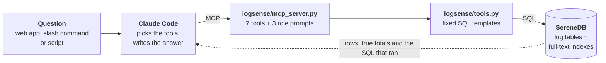

# Serene Overfitters: the right log insights for the right people

An engineer, a team lead and a manager ask questions about the same logs (Loghub BGL and OpenStack), and each gets an answer shaped for their job.
SereneDB does the searching and counting. Claude chooses which tools to call through an MCP server, reads the results and explains them.
Every number in an answer comes with the SQL that produced it.

There are three ways to use it:

- **The web app**: a FastAPI backend (`app/`) and a React frontend (`frontend/`). Pick a role, ask one question, and watch Claude's tool calls and their SQL appear live above the answer. It also has an **Insights** view with charts and a **Setup** view that builds the database.
- **Claude Code** in this folder. It starts the MCP server from `.mcp.json`, and the three roles are slash commands.
- **A recorded investigation** (`python scripts/run_investigation.py`). It runs all three roles headless and saves the answers with every tool call and query.

## Prerequisites

| Tool | Version | Used for | Check with |
|---|---|---|---|
| [Docker Desktop](https://www.docker.com/products/docker-desktop/) | any recent | runs SereneDB 26.10.1 | `docker --version` |
| [Python](https://www.python.org/downloads/) | 3.10 or newer | backend, MCP server, setup scripts | `python --version` |
| [Node.js](https://nodejs.org/) | 20.19+ or 22.12+ (current LTS is fine) | builds and serves the React frontend | `node --version` |
| [Claude Code](https://docs.claude.com/en/docs/claude-code/setup) | latest | the agent that answers questions | `claude --version` |
| Git | any | cloning the repo | `git --version` |

Sign in to Claude Code once by running `claude` in a terminal. The web app uses that login, so each question counts against your Claude plan. Each answer shows what it cost (about $0.50 to $0.70 in our test runs).

You also need about 3 GB of free disk space: 1.5 GB for the raw logs and CSVs, plus the database.

On macOS and Linux, use `python3` and `pip3` wherever this guide says `python` and `pip`, if `python` is not Python 3.

## Installation

### 1. Get the code

```
git clone https://github.com/ahon-rc/Making-Sense-of-Logs-Overfitters.git
cd Making-Sense-of-Logs-Overfitters
```

All later commands run from this folder, the repo root, unless a step says otherwise.

### 2. Start SereneDB

Start Docker Desktop first, then:

```
docker compose up -d
```

This starts SereneDB 26.10.1 on `localhost:7890` in a container named `serenedb`. The database files live in a Docker volume, so they survive restarts. Stop it with `docker compose down`. The data stays until you add `-v`.

### 3. Install the Python packages

A virtual environment is optional but keeps things tidy:

```
python -m venv .venv
.venv\Scripts\activate            # Windows (PowerShell or cmd)
source .venv/bin/activate         # macOS / Linux

pip install -r requirements.txt
```

This installs `mcp`, `psycopg`, `fastapi` and `uvicorn`.

If you use a virtual environment, activate it in every terminal where you run the backend or Claude Code, so `python -m logsense.mcp_server` finds the packages.

### 4. Install the frontend packages

```
cd frontend
npm install
cd ..
```

### 5. Load the logs into SereneDB

```
python scripts/setup_db.py --download
```

This one command does everything:

1. downloads the Loghub OpenStack and BGL archives from Zenodo into `data/raw/`
2. converts the raw logs to `data/openstack.csv` and `data/bgl.csv`
3. creates the tables, loads the CSVs, adds the team-ownership table and the full-text indexes
4. prints the checks: row counts, components without a team, a test search

Converting and loading the 4.7M BGL lines takes a few minutes.

- If you already have the raw files, put them anywhere under `data/` and leave out `--download`. [data/README.md](data/README.md) lists the files.
- If the CSVs already exist, conversion is skipped. Add `--reconvert` to rebuild them.
- You can also run this step later from the web app's **Setup** view, which streams the same output.

`setup_db.py` sends the SQL in `sql/` with the same Python driver the tools use, so you don't need `psql`.
If you prefer `psql`, run `psql -h localhost -p 7890 -U postgres -f sql/rebuild.sql` after the CSVs exist.

## Running the web app

The web app is two processes, each in its own terminal, both started from the repo root:

**Terminal 1: the API** (FastAPI on `127.0.0.1:8000`)

```
python app/server.py
```

**Terminal 2: the frontend** (Vite on `localhost:5173`)

```
cd frontend
npm run dev
```

Open **http://localhost:5173**. The API also tries to open it for you; set `LOGSENSE_NO_BROWSER=1` to stop that.

Vite forwards every `/api/...` request to port 8000, so the browser only talks to `localhost:5173`. If the API runs elsewhere, set `LOGSENSE_API`, for example `LOGSENSE_API=http://127.0.0.1:9000 npm run dev`. To run the API on another port, set `LOGSENSE_PORT`.

The header shows three status pills: SereneDB connected, how many log lines are loaded, and whether Claude Code was found. If any is red, open **Setup** at the bottom of the sidebar.

### Production build (optional)

```
cd frontend
npm run build      # type-checks, then writes static files to frontend/dist/
npm run preview    # serves dist/ on localhost:4173, with the same /api proxy
```

## Using it

### Web app

| View | What it does | Path through the system |
|---|---|---|
| **Chat** (New chat) | Pick Manager, Team lead or Engineer with the **+** button, then ask a question, or click the suggested question for that role. Each tool call Claude makes appears as a card while it runs, with its headline numbers, first rows and the exact SQL. Then the answer appears, with its closing SQL section folded away. Each chat is one question and one answer. Use **Ask another question** to start the next one. Answers are saved to `investigation/runs/`. | browser → `/api/ask` → Claude Code (`claude -p`) → MCP server → SereneDB |
| **History** (sidebar) | Every saved answer, grouped by role and collapsed by default. Clicking one replays it instantly in a new chat, with the same tool cards and answer and no Claude call. | browser → `/api/replay` |
| **Insights** | Charts and tables from the same query functions, without the LLM: totals, non-INFO lines by team, a trend with a full-text filter, the top recurring message patterns, VM spawn times, and log search. Every panel has a **SQL** toggle. Switch between OpenStack and BGL at the top. | browser → `/api/tools/<name>` → query layer → SereneDB |
| **Setup** (bottom of sidebar) | A checklist of what is ready (database, CSVs, tables, indexes, Claude Code, `.mcp.json`) and a **Run setup** button that streams the output of `scripts/setup_db.py`. | browser → `/api/setup` |

### Claude Code

```
claude
```

Run this in the repo folder. Claude Code reads `.mcp.json` and starts the `serenedb-logs` MCP server itself. Approve it when asked, then check with `/mcp` that it shows as connected.

Then either ask a question in your own words, or use a role:

```
/mcp__serenedb-logs__engineer
/mcp__serenedb-logs__team_lead
/mcp__serenedb-logs__manager  Which BGL problems should we look at first?
```

With no text after the command, the role's default question is used.

### Recorded investigation

```
python scripts/run_investigation.py            # all three roles
python scripts/run_investigation.py engineer   # one role
python scripts/run_investigation.py engineer --question "What happened to instance 544fd51c-4edc-4780-baae-ba1d80a0acfc?"
```

For each role this writes `investigation/<role>.md`, which holds the question, the answer, and every tool call in order with its arguments, headline numbers and exact SQL.
The full event stream goes to `investigation/raw/<role>.jsonl`. These answers also appear in the web app's History.

## How it works



- **SereneDB holds the logs**, one row per log line, in typed tables with inverted (full-text) indexes. All searching and counting happens there.
- **The query layer** (`logsense/tools.py`) is seven fixed SQL templates. Claude never writes SQL. It picks a tool and its filters, and every result carries the exact SQL that ran, the scope, the true total, and a `truncated` flag.
- **The MCP server** (`logsense/mcp_server.py`) publishes those functions as tools, with descriptions written for Claude to read. It also publishes the three role playbooks as prompts.
- **The roles** (`logsense/roles.py`) are playbooks, not separate programs. The same agent, tools and data serve all three people. What changes is the question, the evidence each role gathers and the kind of recommendation.

[docs/ARCHITECTURE.md](docs/ARCHITECTURE.md) explains each layer, the web app, the design choices and one question followed end to end.

## Repository layout


| Folder | What's in it | You open it to |
|---|---|---|
| `frontend/` | The React + TypeScript UI (Vite, assistant-ui). `src/App.tsx` is the layout and chat, `src/chat-api.ts` streams answers, `src/Insights.tsx` and `src/Setup.tsx` are the other two views, `src/components/` holds the tool-call card, tables and charts | change the web page |
| `app/` | `server.py`, the FastAPI backend: status, roles, saved answers, replay, tools, ask and setup endpoints | change an API endpoint |
| `logsense/` | The shared Python package: `tools.py` (the 7 SQL queries), `mcp_server.py` (offers them to Claude), `roles.py` (the 3 role playbooks), `agent.py` (runs Claude Code and records its tool calls) | change a query, a tool description or a role |
| `scripts/` | Commands you run: `setup_db.py` builds the database, `logs_to_csv.py` parses the raw logs, `run_investigation.py` records the 3 role answers | set up, or record the investigation |
| `sql/` | The database build, in order: schema, load, team ownership, search indexes, checks | change the tables or the team mapping |
| `data/` | Your raw logs and the generated CSVs (not in git; see [data/README.md](data/README.md)) | add the log files |
| `investigation/` | The saved role answers, each with every tool call and its SQL (`runs/` holds answers asked in the web app) | check what Claude said and why |
| `docs/` | `ARCHITECTURE.md` and this diagram | read the full explanation |

At the top level, `docker-compose.yml` starts SereneDB, `.mcp.json` tells Claude Code how to start the MCP server, `requirements.txt` lists the Python packages, and `.gitignore` keeps the data, `node_modules/`, build output and caches out of git.

## Tools

Every tool returns JSON with `queries` (the exact SQL that ran, with timings and row counts), `scope` (the dataset and filters used) and `truncated`.
Results are capped at 200 rows and messages at 400 characters. Totals are always counted in the database, not from the returned sample.

| Tool | Inputs | Returns |
|---|---|---|
| `corpus_overview` | none | rows, time span and rows per level for each dataset; the time window of each OpenStack source file; the labelled anomaly VMs; BGL alert lines; the team → components mapping |
| `search_logs` | `query` (full-text: `"phrase"`, `OR`, `-exclude`), `dataset`, optional `start`/`end`/`levels`/`team`/`component`/`instance_id`/`node`, `limit`, `order` | matching lines and the exact `total_matching_lines` |
| `get_context` | `dataset`, `around` timestamp, `before_seconds`/`after_seconds`, optional VM/request/node/service/level filters, `limit` | every line in that time window, in order |
| `count_by` | `dataset`, `group_by` (team, component, level or message_pattern; also service, instance_id, http_status and split for OpenStack, node and alert_label for BGL), optional `query`/time/levels/team/component, `top` | per group: lines, share %, distinct VMs or nodes, first and last seen, owning teams; the total in scope and the number of groups |
| `trend` | `dataset`, `bucket` (minute/hour/day/week), optional `query`/time/levels/team/component | lines per bucket, min/median/max per bucket, and the peak bucket |
| `instance_timeline` | `instance_id`, optional `levels`, `limit` | the life of one OpenStack VM in order, plus a summary |
| `duration_stats` | `metric` (spawn/build/destroy/network-deallocate seconds, or API latency), `group_by`, optional time range, `slowest` | count, average, p50, p95 and max per group, plus the slowest individual cases |

`message_pattern` masks ids, long hex strings and numbers, so lines that differ only by a VM id count as one recurring problem.

## The three roles

The roles form a ladder of technical depth. The manager gets plain language, the team lead gets component names, counts and trends, and the engineer gets raw log lines, ids and stack frames.

| | Manager | Team lead | Engineer |
|---|---|---|---|
| **Detail level** | Plain language: no jargon, a few rounded numbers | Some technical detail: components, counts, shares, trends | Full technical detail: raw lines, ids, millisecond timelines, stack frames |
| **Default question** | Which observed problems deserve attention first, and what should happen next? | Which problems recur, how often, and which components or teams are involved? | What failed, in which component, and what happened just before and after? |
| **Evidence it gathers** | team totals for both datasets, the top problems, whether the top one is ongoing, slow-start risk | counts per team and per message pattern for both datasets, hourly or daily trends, spawn-time comparison | full-text search for the error, the events around it, the VM's timeline, how often this exact error occurs |
| **What it recommends** | at most 3 priorities, each with an owner, a next step and a confidence level, plus what the logs can't tell us | the 1–3 problems each team investigates first, and the measurement that will show it is fixed | the likely cause with alternatives, and concrete next checks: commands, config values, follow-up queries |
| **Facts and guesses labelled as** | Measured / What it probably means / Next step | OBSERVED / HYPOTHESIS / NEXT CHECK | OBSERVED / HYPOTHESIS / NEXT CHECK |

Every role states the data scope, counts log lines rather than incidents, never invents costs, downtime or customer impact, and ends with the SQL behind each number. In the web app that SQL section is folded under the answer, one click away.

## Worked investigation

The saved answers are in [investigation/](investigation/). The OpenStack findings are below. The BGL ones are in the role files.

- **Engineer.** The 8 nova-compute ERROR tracebacks all come from the image-cache periodic task (`_run_image_cache_manager_pass`) failing with `InvalidDiskInfo`. `qemu-img info` ran on an instance disk that had been deleted about 20 ms earlier. The answer labels this a likely race between deleting an instance and the cache audit. It is a hypothesis to confirm on the other 7 occurrences.
- **Team lead.** `Unknown base file` warnings are 3,059 of the 3,314 non-INFO OpenStack lines (92%), all from Storage & Images. They appear in 26 of the 32 hours the logs cover, at 37 to 136 lines per hour (median 128), and they drown out the real image-cache errors owned by Platform Runtime.
- **Manager.** Priority 1 is the image-cache warnings, because they are constant and hide real errors. Priority 2 is the image-cache task failures. Slow VM starts are flagged but not ranked: the 4 labelled VMs averaged 38.3 s to spawn against 19.8 s for the other 2,062, and 4 cases are too few to call a trend.

What the data does not establish: user impact, downtime or cost; whether the warnings cause any failure; and the cause of the traceback, which stays a hypothesis.
The three OpenStack files cover separate time windows (05-14 19:39–21:56, 05-16 00:00–06:25 and 05-16 15:15 to 05-17 12:02), so the gaps between them are not outages.

## How this meets the brief

| Criterion | Where to look |
|---|---|
| Role-appropriate insight (30%) | `logsense/roles.py`. Each role uses different tools, evidence and recommendations, not just a different answer length. See `investigation/*.md`. |
| Search and analytics together (25%) | `search_logs` and `get_context` use SereneDB's inverted index, with phrases, OR, exclusions and time filters. `count_by` and `trend` aggregate over the whole tables, joined to team ownership. Every result reports its true total and whether it was truncated. |
| Recommendation quality (25%) | Statements are labelled OBSERVED / HYPOTHESIS / NEXT CHECK, each number links to its SQL, and every answer has a "what we don't know" section. |
| Execution (20%) | `docker compose up -d`, one setup script, then the API and the frontend, tested from a clean copy. The web app shows the workflow live. |
| Best MCP Server (special award) | 7 tools with descriptions written for the agent, allow-listed arguments, row and message limits, errors that list the valid options, and 3 role prompts. |

## Data model

### `openstack_logs` (207,820 rows)

There is one row per line of `openstack_normal1.log`, `openstack_normal2.log` and `openstack_abnormal.log`.

- `ts`, `service` (nova-api, nova-compute or nova-scheduler), `level`, `component` and `message`.
- `request_id` links the API and compute lines of one request.
- `instance_id` is the VM.
- `http_method`, `http_path`, `http_status` and `latency_s` are set on API access lines.
- `is_labelled_anomaly` is true when `instance_id` is one of the 4 ids in `anomaly_labels.txt`.
- `split` and `line_no` point back to the source file and line.

### `bgl_logs` (4,747,963 rows)

There is one row per line of `BGL.log`.

- `ts`, `node`, `component`, `level` and `message`.
- `alert_label` is the Loghub alert category, which is NULL for normal lines, and `is_alert` is its boolean form.

Lines that don't match the expected format are kept with `parsed = false` and the raw text in `message`, so row counts always equal line counts.

## Team ownership (fictional)

The brief asks for an invented component → team mapping, so that counts can be grouped by team. It lives in `sql/03_ownership.sql`.

| Dataset | Component | Team |
|---|---|---|
| openstack | nova.osapi_compute.wsgi.server, nova.api.openstack.wsgi, nova.api.openstack.compute.server_external_events, nova.metadata.wsgi.server | API Gateway |
| openstack | keystonemiddleware.auth_token | Identity & Access |
| openstack | nova.scheduler.host_manager | Scheduling |
| openstack | nova.compute.manager, nova.compute.claims, nova.compute.resource_tracker | Compute |
| openstack | nova.virt.libvirt.driver | Virtualization |
| openstack | nova.virt.libvirt.imagecache | Storage & Images |
| openstack | oslo_service.periodic_task | Platform Runtime |
| bgl | KERNEL | HPC Node Software |
| bgl | APP | HPC User Workloads |
| bgl | MMCS, BGLMASTER, CMCS | HPC Control System |
| bgl | DISCOVERY, HARDWARE, MONITOR | HPC Hardware Ops |
| bgl | LINKCARD, SERV_NET | HPC Network |

Check 2 in `sql/04_checks.sql` lists any component without a team, so gaps show up right after loading.

## Connecting to another SereneDB instance

The tools, setup script and web app read `SERENEDB_HOST`, `SERENEDB_PORT`, `SERENEDB_USER`, `SERENEDB_DB` and `SERENEDB_PASSWORD`. The defaults are `localhost`, `7890`, `postgres`, `postgres` and no password.

- For Claude Code, change the `env` block in `.mcp.json`.
- For the web app (`app/server.py`) and the scripts, set the variables in your shell before running them.

`sql/02_load.sql` reads `/data/openstack.csv` and `/data/bgl.csv` from the database server's own filesystem. A remote instance therefore needs those files at that path, which `docker-compose.yml` arranges for the local one.

## Troubleshooting

- **The status pills say "SereneDB offline"**: Docker Desktop isn't running or the container is stopped. Run `docker compose up -d`, then click **Check again** in Setup.
- **The page loads but nothing else does, and Vite prints `http proxy error ... ECONNREFUSED`**: the API isn't running. Start `python app/server.py` in a second terminal.
- **`'claude' is not recognized`** (Windows): Claude Code is not on your PATH. Reinstall it or open a new terminal. The Setup view shows whether it found `claude`.
- **A question fails straight away with a Claude Code error**: run `claude` once in a terminal and sign in, then try again.
- **`ModuleNotFoundError: No module named 'psycopg'` (or `fastapi`, `mcp`)**: the packages went into a different Python. Activate your virtual environment, or run `python -m pip install -r requirements.txt` with the same `python` you start the server with.
- **`npm run dev` fails with an engine or syntax error**: Node.js is too old. Vite 8 needs Node 20.19+ or 22.12+.
- **Port 5173 or 8000 already in use**: another copy is still running. Stop it, or use `npm run dev -- --port 5174` and `LOGSENSE_PORT=8001` (then start Vite with `LOGSENSE_API=http://127.0.0.1:8001`).
- **Port 7890 already in use**: an older SereneDB container is still running. Remove it with `docker rm -f serenedb`, then run `docker compose up -d`.
- **`role "root" does not exist`** or a password prompt from `psql`: add `-U postgres -d postgres`. The container accepts that user without a password.
- **The MCP server doesn't show in `/mcp`**: start `claude` from the repo folder, so that `python -m logsense.mcp_server` can find the package. Run `pip install -r requirements.txt` in the same Python that `python` points to.
- **`Missing raw files under data/`** from setup: run it with `--download`, or put the raw logs under `data/` as listed in [data/README.md](data/README.md).

## Known limitations

- OpenStack timestamps have no timezone, so they are stored as written.
- `instance_id` is only set when a line names the VM, either as `[instance: …]` or in a `/servers/<id>` URL. Other lines of the same request are reached through `request_id`.
- A Python traceback spans several log lines and each becomes its own ERROR row. Counts are log lines, not separate incidents, and the answers say so.
- Only 4 OpenStack VMs are labelled anomalous, which is too few for statistical claims. The answers treat the spawn-time gap as a signal, not a trend.
- The web app is for one person on one machine. It has no login, and the API only listens on `127.0.0.1`.
- Chats in the sidebar's Recents live in the browser tab only and are gone after a reload. Answers themselves are saved to `investigation/runs/` and stay in History.
